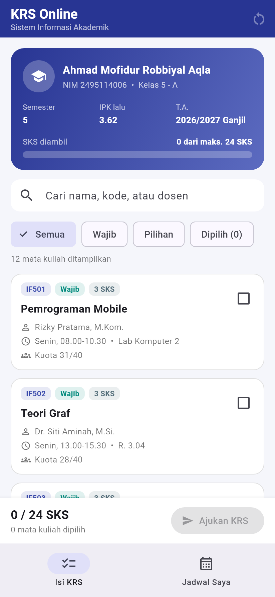
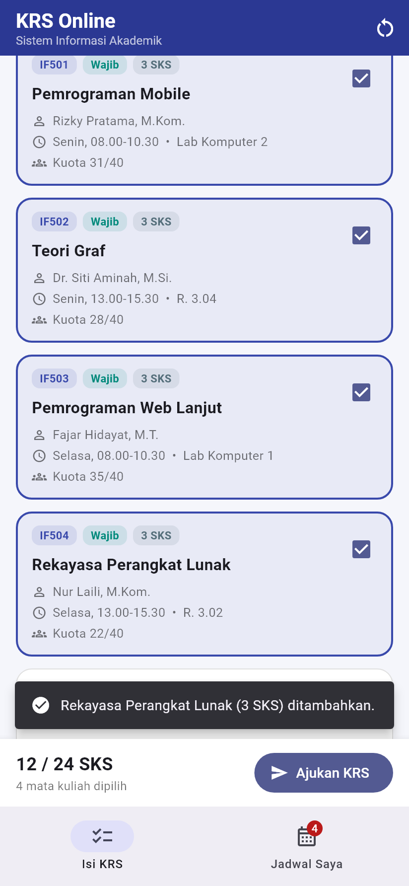
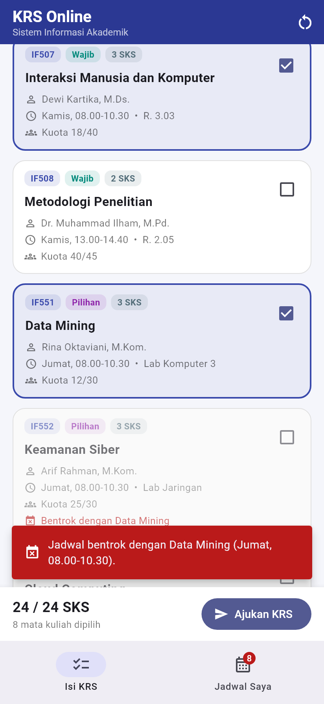
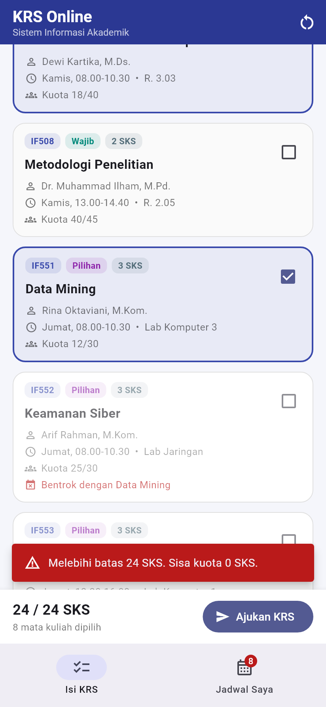
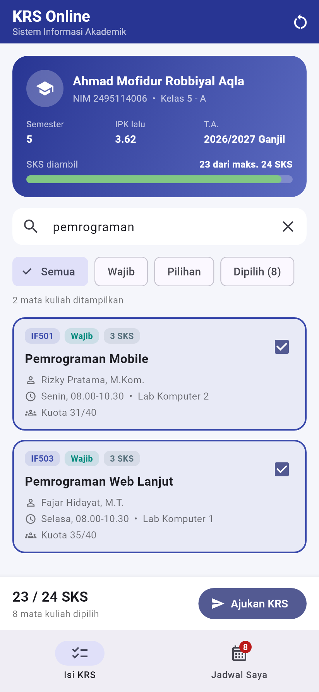
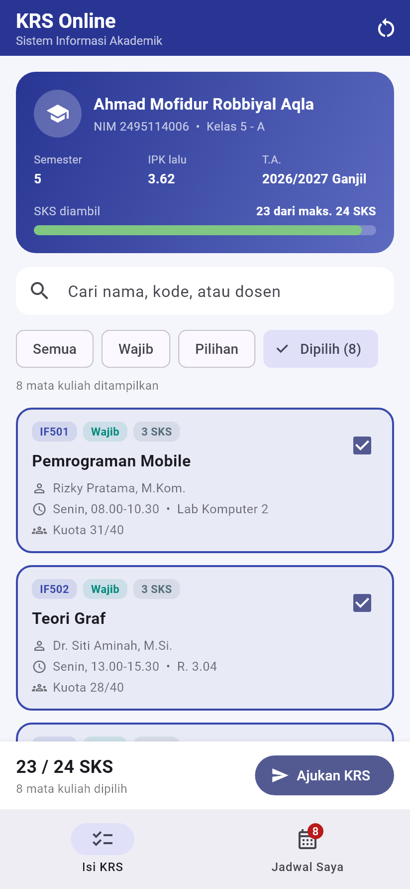
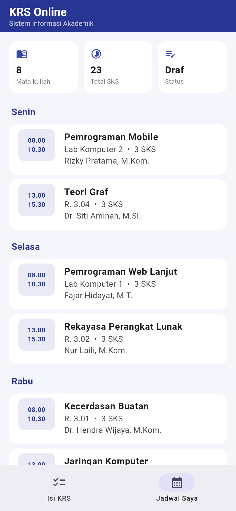
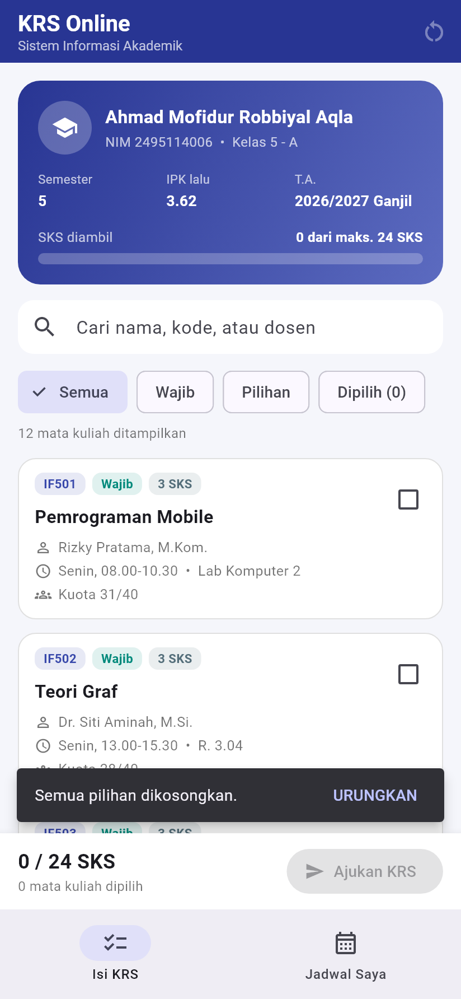
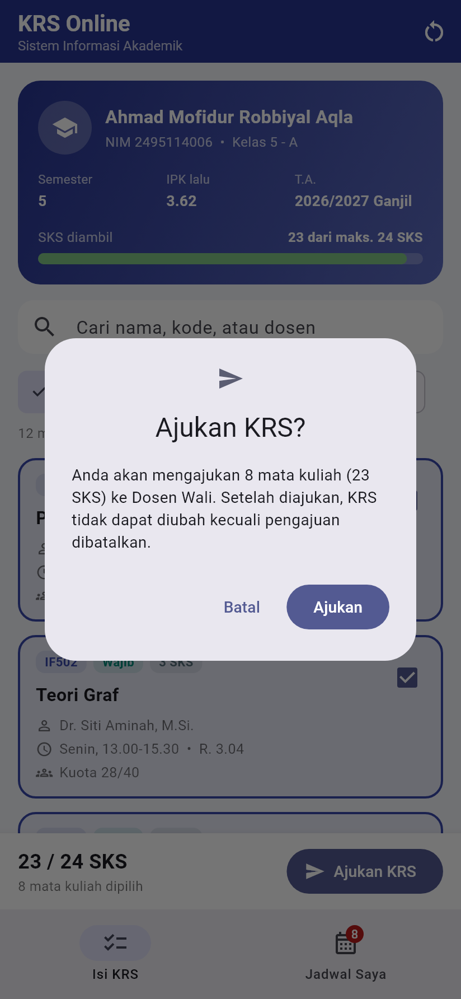
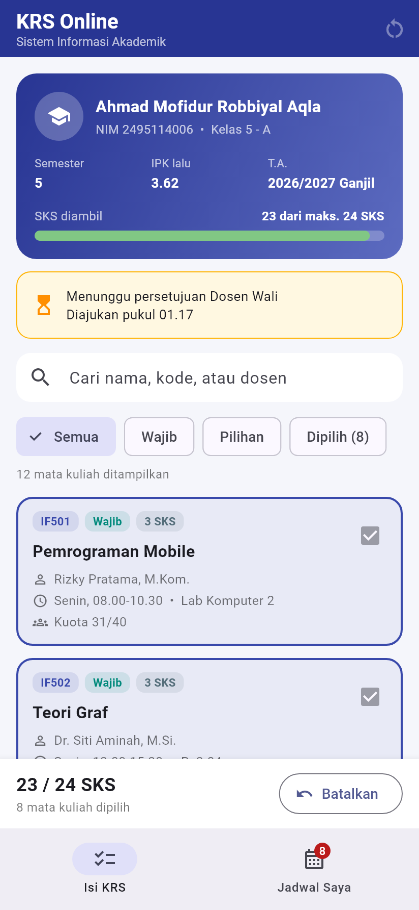

# KRS Online – State dan Interaksi Pengguna

Aplikasi Flutter yang menerapkan **state dan interaksi pengguna** pada studi
kasus nyata di **sistem kampus**: pengisian **Kartu Rencana Studi (KRS)**
oleh mahasiswa. Tugas Mobile Programming Sesi 8.

- **Nama:** Ahmad Mofidur Robbiyal Aqla
- **NIM:** 2495114006
- **Kelas:** 5 - A

## Studi kasus

Setiap awal semester mahasiswa memilih mata kuliah yang akan diambil. Sistem
harus memastikan pilihan itu valid: jumlah SKS tidak melebihi batas yang
ditentukan dari IPK, jadwal tidak bentrok, dan kelas belum penuh. Setelah
selesai, KRS diajukan ke Dosen Wali dan tidak bisa diubah lagi kecuali
pengajuan dibatalkan.

## State yang dikelola

Halaman utama (`KrsPage`) adalah `StatefulWidget`. Semua data yang berubah
karena interaksi pengguna disimpan di `_KrsPageState` dan diperbarui dengan
`setState()`:

| State | Berubah saat | Dampak pada tampilan |
|---|---|---|
| `_kodeDipilih` (Set) | kartu / checkbox mata kuliah ditekan | total SKS, batang progres, warna kartu, lencana jumlah di tab Jadwal |
| `_kataKunci` | mengetik di kolom pencarian | daftar mata kuliah tersaring langsung |
| `_filter` | memilih ChoiceChip Semua / Wajib / Pilihan / Dipilih | daftar sesuai jenis |
| `_tab` | menekan NavigationBar | berpindah tab Isi KRS ↔ Jadwal Saya |
| `_status` | Ajukan KRS / Batalkan | KRS terkunci, banner "Menunggu persetujuan", tombol berganti |

## Interaksi pengguna

- **Centang mata kuliah** → divalidasi dulu (`AturanKrs.cekTambah`):
  - jadwal **bentrok** dengan mata kuliah lain → ditolak + SnackBar merah;
  - **kelas penuh** → ditolak;
  - **melebihi batas SKS** (24 SKS untuk IPK ≥ 3,00) → ditolak.
- **Hapus pilihan** dengan menekan kartu yang sudah dicentang.
- **Pencarian** berdasarkan nama, kode, atau dosen (TextField + tombol hapus).
- **Filter** dengan ChoiceChip.
- **Kosongkan pilihan** (ikon di AppBar) dengan aksi **URUNGKAN** di SnackBar.
- **Ajukan KRS** dengan dialog konfirmasi (`showDialog`), lalu KRS terkunci.
- **Batalkan pengajuan** untuk membuka KRS kembali.
- Tab **Jadwal Saya** menyusun jadwal mingguan dari mata kuliah yang dipilih.
- Animasi kecil saat state berubah: `AnimatedContainer` pada kartu dan batang SKS.

## Struktur folder

```
lib/
├── main.dart                      # MaterialApp + tema
├── data/data_krs.dart             # data mahasiswa & mata kuliah yang ditawarkan
├── models/
│   ├── mata_kuliah.dart           # model MataKuliah, status, hasil validasi
│   └── aturan_krs.dart            # aturan: total SKS, bentrok, kuota, batas SKS
├── pages/
│   ├── krs_page.dart              # StatefulWidget utama (setState)
│   └── jadwal_tab.dart            # tab Jadwal Saya
└── widgets/
    ├── kartu_mahasiswa.dart       # identitas + batang progres SKS
    └── kartu_mata_kuliah.dart     # kartu mata kuliah + checkbox
test/widget_test.dart              # 11 pengujian aturan & interaksi
```

## Menjalankan

```bash
flutter pub get
flutter run
flutter test
```

## Hasil tampilan jalannya aplikasi

Video jalannya aplikasi (± 2 menit): [video/demo_krs_online.mp4](video/demo_krs_online.mp4)

| Tampilan awal | Memilih mata kuliah | Jadwal bentrok |
|---|---|---|
|  |  |  |

| Melebihi batas SKS | Pencarian | Filter "Dipilih" |
|---|---|---|
|  |  |  |

| Jadwal Saya | Kosongkan + urungkan | Dialog ajukan |
|---|---|---|
|  |  |  |

| KRS diajukan (terkunci) |
|---|
|  |
